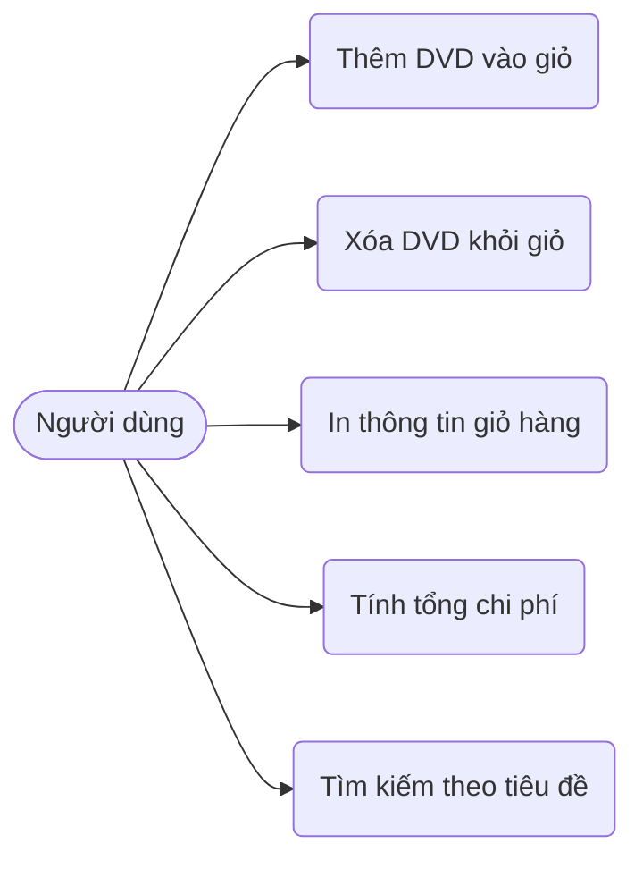

# Sơ đồ và Mô tả Use Case – Dự án AIMS-mini

## 1. Danh sách Use Cases chính
1. **Thêm đĩa DVD vào giỏ hàng (Add DVD to Cart)**:
   - Cho phép người dùng thêm một đĩa DVD vào giỏ hàng.
   - Kiểm tra giới hạn tối đa `MAX_NUMBERS_ORDERED` (20 đĩa). Nếu vượt quá giới hạn, từ chối thêm.
2. **Xóa đĩa DVD khỏi giỏ hàng (Remove DVD from Cart)**:
   - Cho phép người dùng loại bỏ một đĩa DVD đang có trong giỏ hàng.
3. **In thông tin giỏ hàng (Print Cart)**:
   - Hiển thị danh sách các đĩa DVD đã chọn, định dạng thông tin chi tiết từng đĩa.
   - Nếu giỏ hàng trống, thông báo "The cart is empty".
4. **Tính tổng chi phí (Calculate Total Cost)**:
   - Tính tổng giá trị tất cả các sản phẩm có trong giỏ hàng.
5. **Tìm kiếm đĩa theo tiêu đề (Search by Title)**:
   - Tìm kiếm danh sách các đĩa DVD khớp với từ khóa tìm kiếm.

## 2. Sơ đồ Use Case (Mermaid)

